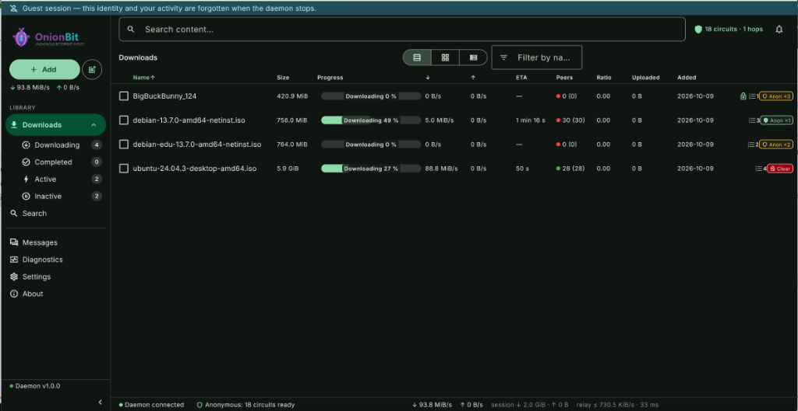
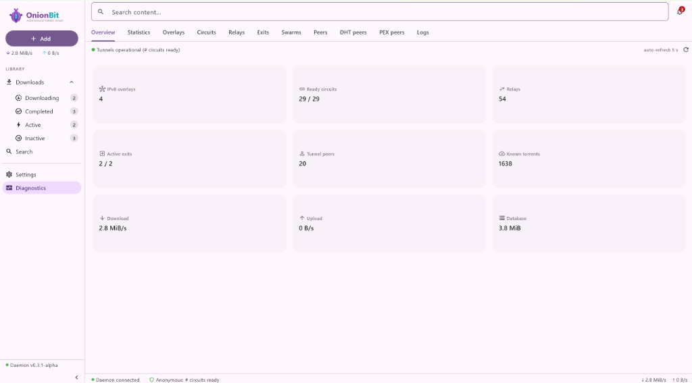
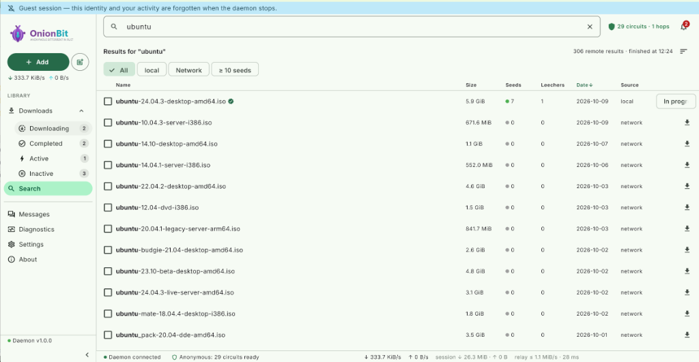
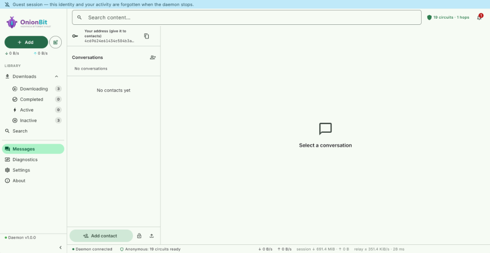

<div align="center">


### The portable anonymity swiss army knife

**One peer-to-peer network, no servers: share files, chat privately,
browse `.onion` — and carry the whole thing on a USB stick.**

[](LICENSE)
[](https://www.rust-lang.org/)
[](https://flutter.dev/)
[](https://github.com/laurentgeynet-ux/OnionBit/actions/workflows/ci.yml)
[](docs/interop/README.md)
[](https://github.com/laurentgeynet-ux/OnionBit/pkgs/container/onionbit)

[Features](#what-you-get) ·
[Evidence](#proof-not-promises) ·
[Install](#get-it) ·
[Screenshots](#screenshots) ·
[Docs](docs/INDEX.md)

</div>

---

## What is OnionBit?

A peer-to-peer ecosystem for people who can't trust the network —
nomadic, censored, or just private. **No servers, no accounts, no
phone numbers.** Your device talks to other devices through encrypted
multi-hop onion circuits, and everything you need rides on top:
file sharing, messaging, identity, hidden services — even its own
`.onion` browser. Rust engine, Flutter UI, runs everywhere, leaves
no trace by default.

## What you get

| | |
|:---|:---|
| 📁 **Anonymous BitTorrent** | Downloads and hidden seeding over up-to-3-hop onion circuits — peers see a relay, never you. Wire-compatible with **Tribler 8.x** |
| 💬 **Serverless e2e messaging** | Your public key *is* your address. 1-to-1 and groups, file attachments as private swarms, consent before anything — and **store-and-forward** so offline contacts get their messages via relays |
| 🪪 **Portable identity** | One 24-word recovery phrase restores your whole identity on any device. Guest mode keeps nothing at all |
| 🧅 **`.onion` everywhere** | Embedded **Tor (Arti)** — stable `.onion` addresses for your identity, channels and vault; `.onion` services reachable like any contact |
| 🌐 **Built-in `.onion` browser** | **[OnionBit-Browser](https://github.com/laurentgeynet-ux/onionbit-browser)** — a faithful Rust port of Dillo, launched confined through the Tor proxy with an ephemeral profile that wipes itself on exit. Measured `NO_LEAK`, not promised |
| 🗄️ **Encrypted vault** | Private download zone (`.obd` chunks) plus a replicated **store-and-forward vault** — offline peers can drop encrypted blobs for you |
| 🥷 **Stealth transport** | A censorship mode with *no static protocol marker at all*: morphed wire format, `onionbit-bridge://` invitations, uniform silence under probing |
| 🎚️ **One-switch privacy profiles** | `Compatible` / `Full anonymous` / `Custom` — one control, ~20 settings applied atomically |
| 🔒 **Encrypted local database** | SQLite sealed per-page with ChaCha20-Poly1305 (sqlite3mc) — history, contacts, messages protected at rest |
| 📦 **Signed updates** | Releases shipped as signed `OBUP` packages — verify before swap, never a placeholder key |
| 🤝 **Trust without blockchain** | Signed curator attestations, bilateral ledgers, trust-gated messaging — reputation between peers |

## Proof, not promises

Every line is reproducible — the evidence lives in the repo:

- **Interop measured**: bidirectional hidden-service transfers with
  unmodified Tribler 8.4.3, 2- and 3-hop, kill/recovery scenarios →
  [docs/interop](docs/interop/README.md)
- **Fingerprinting measured**: 9/9 oracles PASS against two real stealth
  daemons — probing silence, amplification 0, zero static marker →
  [docs/security/fingerprinting.md](docs/security/fingerprinting.md)
- **Browser leak-proof measured**: real `.onion` sessions watched per-PID —
  all TCP to the loopback proxy, zero UDP, zero child processes,
  per-origin Tor circuit isolation → `scripts/sec_browser_leak.ps1`
- **Encrypted DB probed at runtime**: the sqlite3mc codec is verified
  live before any keyed database opens — fail-closed, never silently plaintext
- **32 Architecture Decision Records**, a threat model written *before*
  the features, ~580 Rust + ~85 Flutter tests, fuzzing journal →
  [docs/THREAT-MODEL.md](docs/THREAT-MODEL.md)

## Honest limits

No independent audit yet — keep the usual caution for high-stakes use.
Onion routing reduces linkability, it doesn't erase traffic *volume* or
*timing*. `Full anonymous` only works against a deployed OnionBit stealth
fleet (bridges/gateways) — it is an enclave, not magic. The `.onion`
browser is a minimal Dillo-class reader, not a Tor Browser — see the
[threat model](docs/THREAT-MODEL.md).

## Get it

**Download**: [Releases](https://github.com/laurentgeynet-ux/OnionBit/releases)

- **Windows x64** — portable zip: unzip, run `OnionBit` — done.
  `state\` and `data\` live beside the binary; carry the folder, keep
  your identity
- **Linux x64** — `.deb` (menu entries + systemd unit) or portable tarball
- **Android** — APK: a remote client, pairs to your daemon by QR code
- **Docker** — `ghcr.io/laurentgeynet-ux/onionbit`:

```bash
docker run -d --name onionbit --network host \
  -v ./data:/data --restart unless-stopped \
  ghcr.io/laurentgeynet-ux/onionbit:latest
# bridge node: add -e ONIONBIT_PROFILE=bridge
```

**From source** — Rust stable + Flutter stable:

```bash
cargo build --release -p onionbit-daemon   # engine + API on 127.0.0.1:8085
cd app && flutter run -d windows           # the UI (or linux/chrome/android)
```

Full guide: [docs/BUILDING.md](docs/BUILDING.md) · Docker recipes:
[docs/docker.md](docs/docker.md)

| Platform | Status |
|:---|:---|
| Windows x64 / ARM64 | ✅ portable bundle / headless zip |
| Linux x64 | ✅ `.deb` + portable tarball |
| Web UI | ✅ served same-origin by the daemon |
| Docker | ✅ ghcr.io image, all profiles |
| Android | ✅ APK remote client (QR pairing) |
| macOS / iOS | 🔨 builds from source |

## Screenshots

| Downloads | Diagnostics | Search | Messaging |
|:---:|:---:|:---:|:---:|
|  |  |  |  |

*Dark/light themes, English & French, adaptive from phone to desktop.*

## Under the hood

Rust workspace — 14 crates: BitTorrent engine (on
[librqbit](https://github.com/ikatson/rqbit)), IPv8-style overlay with
multi-hop tunnels, e2e messaging, Tor runtime (Arti), REST+SSE control
plane — plus a Flutter UI and an embedded Dillo-class browser
([its own repo](https://github.com/laurentgeynet-ux/onionbit-browser)).
*Born as a Rust port of [Tribler](https://github.com/Tribler/tribler),
now its own ecosystem — still wire-compatible with Tribler 8.x.*

Deep dives: [docs/INDEX.md](docs/INDEX.md) ·
[32 ADRs](docs/architecture/decisions/) ·
[threat model](docs/THREAT-MODEL.md) ·
[interop evidence](docs/interop/README.md)

## More from this forge

- **[onionbit-browser](https://github.com/laurentgeynet-ux/onionbit-browser)** — a faithful Rust port of the Dillo web browser; standalone, and OnionBit's embedded `.onion` reader
- **[BitDeamonRust](https://github.com/laurentgeynet-ux/BitDeamonRust)** — a 100% safe Rust BitTorrent engine, faithful port of libtorrent (Rasterbar) — same wire behavior and `.session` formats, verified against real swarms
- **[eMule-Rust](https://github.com/laurentgeynet-ux/eMule-Rust)** — a modern eD2K/eDonkey + Kad client in Rust: Tokio daemon, JSON-RPC API, Flutter UI, MCP server

## Contributing & License

Contributions welcome — see [CONTRIBUTING.md](CONTRIBUTING.md).

Copyright (C) 2026 Laurent Geynet —
[GPL-3.0-or-later](LICENSE), inherited from Tribler. Security reports:
[SECURITY.md](SECURITY.md).

---

<div align="center">
<b>OnionBit</b> — peel the layers, not your privacy. 🧅
</div>
